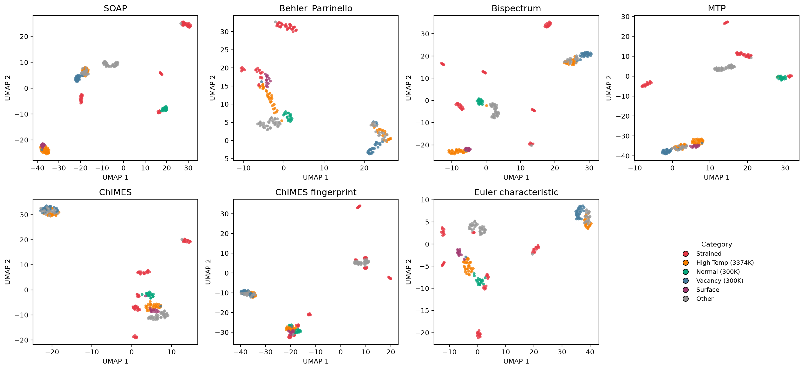
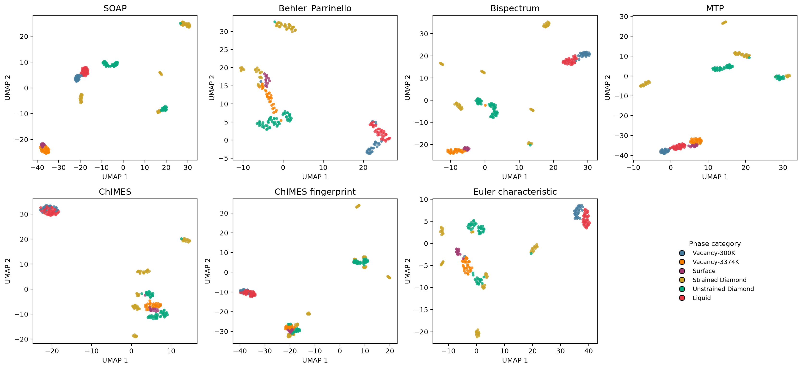
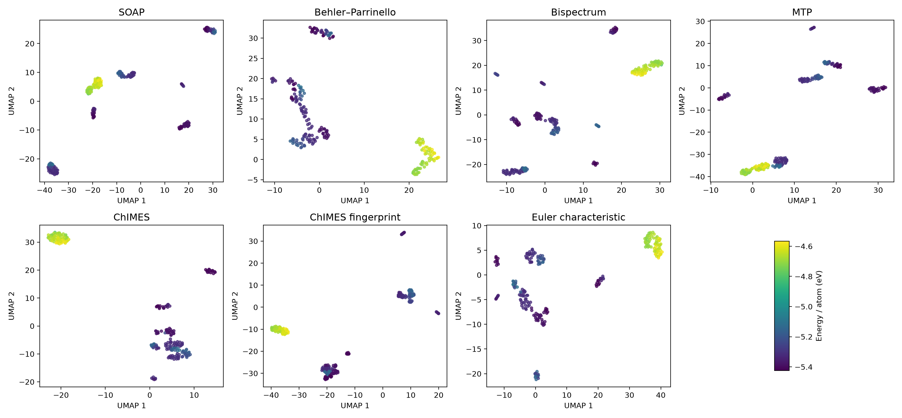

# Unsupervised baseline UMAPs

Fully unsupervised UMAP of the Si latent spaces of the manuscript: SOAP, Behler–Parrinello,
bispectrum and MTP (per-atom mean), ChIMES (A-matrix energy row / N), the full-frame
ChIMES fingerprint (α = 1) and the Euler characteristic curve.
**All category and energy colours are post-hoc overlays** — UMAP and FPS never see labels or energies.

Baseline settings: `init=spectral`, `min_dist=0.9`, `n_neighbors=15`, `metric=euclidean`, `random_state=42`.

UMAP is visualization only. FPS runs in the standardised high-dimensional space, and
UMAP preserves local neighbourhoods rather than the distances FPS uses, so read these
maps qualitatively; the quantitative counterparts are the manuscript figures
`figures/Si_mean/fig_distance_analysis.png` (distances vs selection) and
`figures/Si_mean/fig_crossspace.png` (agreement between spaces).

> **Descriptor definitions (updated 2026-11-05).** The first version of this study built
> its own descriptors with the original Si pipeline: mean ‖ std aggregation, bispectrum
> SNAP fitting rows (`pot_fit=True`) and a ChIMES descriptor pooled from A-matrix force
> rows, whose across-atom mean is identically zero. The study now embeds the corrected
> latent spaces of the `lsp` package, so its panels match the manuscript's analyses, and
> the observations below were rewritten from the regenerated figures.

---

## Files you generate (step by step)

All commands below are run from the **repo root**.

### Step 0 — Environment and data

```bash
uv sync
python scripts/fetch_mlearn_data.py Si      # external/mlearn/Si/training.json (214 frames)
```

### Step 1 — Latent spaces (lsp cache)

The descriptors are the `lsp` caches `results/Si/descriptors/<space>.npy` (gitignored).
They are computed on first use from `configs/Si.json`; the bispectrum and the ChIMES
fingerprint need the local executables in `configs/local_paths.json`, and the ChIMES
spaces need the ChIMES fit inputs in `external/chimes/Si/` (see the root README). To
build them explicitly:

```bash
python scripts/run_pipeline.py Si --stage descriptors
```

### Step 2 — Phase labels JSON (optional record)

| Output | Path | In git? |
|--------|------|---------|
| Labels | `analysis/umap/unsupervised/data/data_phase_categories.json` | yes (regenerable) |

```bash
python analysis/umap/unsupervised/scripts/relabel_phase_categories.py
```

Applies `analysis/categorization.py` to every frame and writes `index`, `description`,
`group`, `category` and `phase_category` (labels only; no geometries or DFT outputs).
The figure generator applies the same rules directly.

### Step 3 — UMAP figures (PNGs)

| Output | Path | In git? |
|--------|------|---------|
| Legacy categories | `figures/original_categories/umap_by_category.png` | yes |
| Phase categories | `figures/phase_categories/umap_by_phase.png` | yes |
| Energy / atom | `figures/energy_per_atom/umap_by_energy.png` | yes |

```bash
python analysis/umap/unsupervised/scripts/generate_unsupervised_umaps.py
# --force-recompute rebuilds the lsp descriptor caches first
```

---

## Data preprocessing

**Per frame:** one structure-level vector per latent space.

| Space | Width | Structure-level vector |
|---|---|---|
| SOAP | 324 | per-atom mean of the power spectrum (r_cut 5.4 Å, n_max = l_max = 8, σ = 0.5 Å) |
| Behler–Parrinello | 27 | per-atom mean of the G2 + G4 symmetry functions |
| Bispectrum | 55 | per-atom mean of the bispectrum coefficients (`pot_fit=False`) |
| MTP | 864 | per-atom mean of the level-24 moment-tensor basis functions |
| ChIMES | 473 | A-matrix energy row / N (per-atom cluster-polynomial sums, 6/10/4 fit) |
| ChIMES fingerprint | 300 | 2-, 3- and 4-body cluster-distance histograms (100 bins each) |
| Euler characteristic | 64 | χ(r)/N of the periodic Rips filtration, 0–6 Å |

**Full dataset (214 frames):** stack → z-score every feature → UMAP → 214 × 2 (plot only).

---

## Original categories



- **Strained** cells form several separate islands (elastic mode and strain magnitude) in
  every space, including both ChIMES spaces. Bispectrum and the Euler curve split them
  into the most islands.
- **Vacancy (300K)** sits next to the high-temperature bulk frames ("Other" and "High
  Temp") in one island in every space.
- **Surface** frames stay compact. They lie next to the 3374 K vacancy frames in SOAP,
  bispectrum, Behler–Parrinello, MTP and the Euler curve, and inside the mixed
  crystal-like cluster in ChIMES and the ChIMES fingerprint.
- **Normal (300K)** bulk frames form their own cluster in every space except the ChIMES
  fingerprint, where they merge with other near-crystalline frames.

## Phase categories



- **Liquid and Vacancy-300K share one island in all seven spaces.** It is also the
  high-energy island of the energy map below.
- **Vacancy-3374K stays with the solids, not with the liquid.** The hot vacancy snapshots
  remain crystal-like (four-fold coordinated) and sit at low energy per atom; every space
  places them next to Surface or Unstrained Diamond. MTP is the one space where they lie
  directly beside the liquid island.
- **Strained vs Unstrained Diamond** separate in every space; the strained cells
  fragment into mode/magnitude islands, as above.
- **The ChIMES fingerprint mixes the most.** Unstrained Diamond, Vacancy-3374K, Surface
  and some strained cells share clusters there, consistent with it being the latent
  space least like the others (distance-rank agreement 0.5–0.6 with every other space in
  `fig_crossspace`).

## DFT potential energy / atom



Same embeddings as the category maps; only the colour changes.

- In every space, the high-energy frames (about −4.8 to −4.6 eV/atom: liquid and
  300 K vacancy) form a single island, and the low-energy frames split into several
  islands by structure (crystal, strain modes, hot vacancies, surfaces).
- Structure, not energy, drives the splits among the low-energy frames.

---

## FPS implications (measured)

The first version of this README listed hypotheses drawn from the maps. Measured FPS
enrichment at ≤ 10 % retention (share in the cut / share in the dataset;
`results/Si/analysis/distance_selection.csv`):

| Category | SOAP | BP | Bisp. | MTP | ChIMES | ChIMES FP | Euler |
|---|---|---|---|---|---|---|---|
| Surface | 3.4 | 1.3 | 2.1 | 5.0 | 1.1 | 0.7 | 4.6 |
| Vacancy 300 K | 1.3 | 2.6 | 2.3 | 1.8 | 1.8 | 0.4 | 1.7 |
| Bulk 3374 K | 1.0 | 1.0 | 1.3 | 1.8 | 2.7 | 3.1 | 2.0 |
| Strained | 1.2 | 1.4 | 1.2 | 0.8 | 1.5 | 1.9 | 0.9 |

- SOAP, MTP and the Euler curve oversample surfaces most strongly; the ChIMES
  fingerprint undersamples them.
- Both ChIMES spaces favour the hot liquid frames instead, and the fingerprint also
  favours strained cells.
- The compact, isolated islands on the maps are the categories FPS picks first, but the
  maps alone do not rank them reliably; use the enrichment table and `fig_distance_analysis`.
